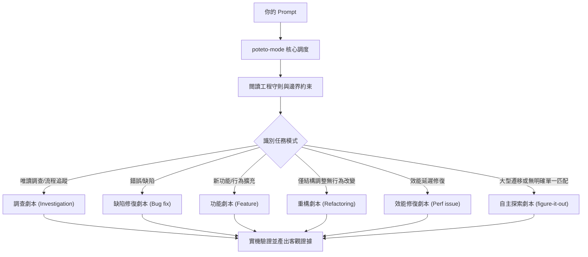

# 透過 `/poteto-mode` 路由任務

`/poteto-mode` 是整個體系的大門。你交給它一個目標，它會自動匹配 23 套內建 Playbooks（劇本）之一，將該劇本的標準步驟展開至任務清單，並在各階段調用相應技能。在本章中，你將學會如何寫出高效率的 Prompt，以及為什麼你其實不需要長篇大論。


---

## 1. 任務接收與路由流程



上圖展示了常見的路由路線。除此之外，專案還內建了指標爬坡 (hillclimb)、執行期追蹤 (trace-forensics)、原型驗證 (prototype)、畫面像素對齊 (visual-parity)、技能開發與評估 (authoring/eval)、開啟 PR (opening-a-pr)、PR 監護 (babysit)、多階段遷移編排 (orchestrate) 等共 23 個劇本（完整清單可查閱 [Playbooks 目錄](../../.agents/skills/poteto-mode/playbooks/)）。

---

## 2. 表達目標與約束，而非繁瑣儀式

你不需要撰寫冗長的規格說明書。只需說明「問題是什麼」或「你想達成什麼」，並附上你已知的事實：

```text
/poteto-mode 重試後使用者會收到兩次通知。請先重現問題，修復後進行驗證。
```

這是一段標準的「缺陷修復 (Bug fix)」提示。「先重現 (repro first)」是一項硬性約束，劇本會嚴格遵守。你會看見任務清單自動填入修復步驟；如果某個步驟被略過，清單中會清楚保留 `skip: <原因>`。

當對話已經具備上下文時，Prompt 可以精簡到極致：

```text
/poteto-mode 繼續執行
```
或
```text
繼續，直到完成並出示驗證證據
```

極簡的指令之所以有效，是因為 `/poteto-mode` 具有會話黏性，而 Playbook 保障了嚴謹度。你的文字傳達意圖，Skill 與 Playbook 負責把關工程品質。

---

## 3. 切換任務：使用 "new task"

長時間的會話會累積舊任務的上下文。當你準備切換主題時，務必明確指出：

```text
/poteto-mode new task. 調查為什麼登出後快取資料依然存在。先不要修改任何代碼。
```

`new task` 會強制 `/poteto-mode` 重新匹配劇本，而不是把新問題當成上一項任務的後續步驟；`先不要修改代碼` 則能精確將任務鎖定在「唯讀調查 (Investigation)」劇本。

---

## 4. 為平行任務劃分獨立 Worktree

當你需要多個任務或多個 Subagent 平行作業時，為避免互相干擾代碼工作區，可在開頭要求隔離：

```text
/poteto-mode new task. 從 <base> 開出獨立 worktree，將 parser 的修改移植過去。
```

這可保證各個任務互不踩踏檔案。在 Windows 環境下，本專案已完全相容 cross-platform 工作區審計腳本。當磁碟空間吃緊時，只需發問：

```text
/poteto-mode 檢查哪些 worktree 已經安全合併，幫我清理可以刪除的目錄。
```

[Worktree 清理劇本](../../.agents/skills/poteto-mode/playbooks/worktree-cleanup.md) 會自動檢查合併狀態、未提交變更與關聯對話，只安全清除已完成的分支目錄。

---

## 5. 離席交付：設定完成條件

當你準備離開螢幕時，給出明確的「完成定義 (Definition of Done)」：

```text
/poteto-mode 我要離開了。持續推進直到遷移檢查回報 0 個舊呼叫點。記錄你的所有決策。
```

需要事後審查的工作會自動路由至 [`figure-it-out`](../../.agents/skills/figure-it-out/SKILL.md)，它會規劃執行階段並啟用 [`show-me-your-work`](../../.agents/skills/show-me-your-work/SKILL.md) 紀錄決策日誌。等你回來時，只需輸入 `/ketchup` 即可快速掌握進展與待決策事項。

> [!WARNING]
> **常見誤區**：不要在 Prompt 中手動排列 Skill 序列（例如「先用 /how，再用 /architect，然後 /arena...」）。Playbook 已經針對各情境設計了最佳步驟，手寫指令往往會破壞劇本設定的防護網。

---

下一章：[變更前深入理解代碼](./03-understand.md)
