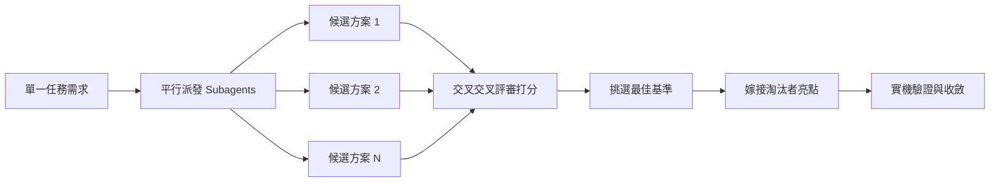

# 架構設計與多方案競爭

若在面對困難的設計時只做一次嘗試，系統架構將被模型最初蹦出的念頭給鎖死。在 pstack 體系中：`/architect` 負責在實現前鎖定型別與邊界契約；`/arena` 讓多個方案同台競技並嫁接優點；`/interrogate` 派發紅隊角色進行極限破壞測試；而面對全域覆蓋任務時，`/swarm` 則能平行派發海量工作者並收斂成果。


---

## 1. 透過 `/architect` 鎖定架構介面

```text
/architect 在編寫代碼前先設計匯入管線（import pipeline）。我最在乎呼叫端的使用體驗。
```

[`architect`](../../.agents/skills/architect/SKILL.md) 調度專案自訂的 [`code-architect`](../../.agents/agents/code-architect.md) 角色。它會先透過 `/how` 掌握既有代碼架構，再透過 `/why` 理解模組歸屬動機，接著調用 `/arena` 產生競爭性的型別草圖、函式簽名與模組關係圖。

預設情況下它會在設計綜合後直接推進實作。如果你希望在編寫代碼前親自確認設計，可以加上檢查點：

```text
/architect with checkpoint. 設計完成後先停下來向我展示，確認後再實作。
```

---

## 2. 透過 `/arena` 展開多方案競技

```text
/arena 將我的需求送入競技場。我想比較多個不同的架構提案與實作取向。
```

[`arena`](../../.agents/skills/arena/SKILL.md) 充分發揮 Antigravity 的 `invoke_subagent` 原生能力：



多個子代理在各自隔離的上下文或目錄中獨立嘗試相同需求。評審子代理依據評分準則評定候選方案，協調者最後挑選最優架構作為基準，並將其他方案的亮點特點嫁接進來，最後完成實機驗證。

---

## 3. 透過 `/swarm` 進行平行矩陣覆蓋

```text
/swarm 檢查 packages/ 目錄下的每個套件，每個套件由一位獨立 worker 執行驗證，最後產出單一匯總報告。
```

[`swarm`](../../.agents/skills/swarm/SKILL.md) 適用於水平切分的獨立任務。每個子代理獲取自己的獨立範圍，執行完成後回報 `PASS`、`ISSUES` 或 `BLOCKED`。主代理會過濾掉瑣碎的中間輸出，僅回傳清晰緊湊的矩陣報告。

---

## 4. 透過 `/interrogate` 進行紅隊對抗性審查

```text
/interrogate 審查整個分支，抱持懷疑態度。除非是真實的 Bug 或行為回歸，否則不要挑剔程式碼風格瑣事。
```

[`interrogate`](../../.agents/skills/interrogate/SKILL.md) 調用自訂的 [`code-adversary`](../../.agents/agents/code-adversary.md)（紅隊極限邊界獵人），並調度多個獨立視角的審查子代理。

它將所有發現分類為四種嚴格等級：
- **`Act on`（立即修復）**：確鑿的邏輯缺陷或安全回歸。
- **`Consider`（深入考慮）**：潛在的效能或維護風險。
- **`Noted`（純粹記錄）**：非關鍵觀察。
- **`Dismissed`（駁回忽略）**：誤報或無效挑剔，**每一項都附帶明確駁回理由**。

主代理絕不會盲目修改代碼，而是將駁回記錄與處理建議清楚攤開供你裁決。

---

## 5. 任務該採用多高規格的設計？

並非所有任務都需要啟動全面競技。建議的階梯對應如下：

- **小規模已完成的改動，心存疑慮**：直接調用 `/interrogate` 進行紅隊審查。
- **跨模組、改動核心介面或轉移資料所有權**：使用 `/architect`，由它自動啟動 `/arena` 產生方案。
- **單一局部決策（如演算法取捨、資料結構格式設計）**：直接使用 `/arena` 產生 3~5 個候選。
- **大量平行測試、批次遷移檢查**：使用 `/swarm` 派發矩陣工作者。
- **不可逆或代價高昂的核心變更**：使用 `/architect` 設計並落實，在合併前通過 `/interrogate` 嚴格審查。

---

下一章：[構建與代碼淨化](./05-build-and-clean.md)
