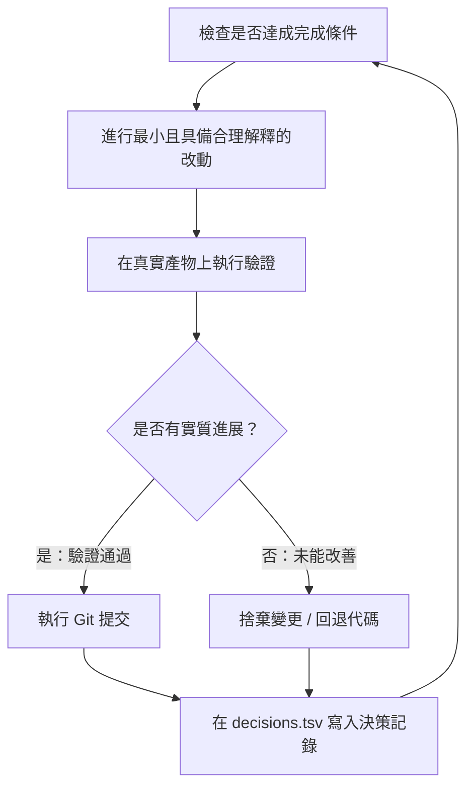

# 夜間自主運行與決策審計

這是整個工程體系的高價值回報。一個值得信賴、能夠自行驗證代碼的 Agent，是你敢於放手讓它在夜間自主攻堅困難任務的前提。保證自主運行安全的不是祈禱，而是**客觀可驗證的完成條件**、**完全隔離的獨立分支**，以及**早晨一目了然的決策審計日誌**。


---

## 1. 隔夜自主協約 (The Overnight Contract)

一份合格的離席託付應該包含：具體目標、完成定義、操作授權，以及安全脫退機制：

```text
/poteto-mode 我準備休息了。在獨立 worktree 中將所有呼叫端遷移至新版 Parser。
完成條件：舊呼叫端數量歸零、全部 Parser fixtures 通過、舊 API 徹底刪除。
保持決策日誌記錄。提交前不需向我詢問。
使用 /goal 持續推進直到完成。如果真的卡住無法前進，停下來並寫明卡點與原因。
```

解析每句話背後的保護機制：
- **「我準備休息了」**：覆蓋互動模式，Agent 不會因微小瑣事停下來等待人類輸入。
- **「完成條件是...」**：將抽象目標轉化為每次循環都能執行的客觀測試。
- **「在獨立 worktree」**：確保夜間自主運行絕不污染你當前編輯中的代碼區。
- **「提交前不需詢問」**：預先授予常規提交許可。
- **「使用 `/goal`」**：調用 Antigravity 原生長期目標機制（或搭配 `schedule` 背景任務），使其在未達成驗證前持續推進。
- **安全脫退機制**：允許 Agent 在遭遇無法跨越的客觀阻礙時優雅停下並報告原因，防範長達數小時的無效自我循環。

---

## 2. 夜間自主循環的運作邏輯



在每一次循環中：**一處改動、一次真實驗證、一行決策日誌**。無效的改動立即回退，絕不僥倖保留；陷入瓶頸時嘗試轉換策略，絕不擅自放寬驗證標準宣告虛假勝利。

---

## 3. 早晨決策審計：`/show-me-your-work`

讓整晚工作可供人類審查的關鍵是 [`show-me-your-work`](../../.agents/skills/show-me-your-work/SKILL.md)。在 Windows 與各平台環境下，它會將每一次決策點、動機、證據檔案與執行結果記錄於 `decisions.tsv`（由 `log.mjs` / `log.ps1` 跨平台支援）。

當你早晨回到電腦前時，只需輸入：

```text
/show-me-your-work 總結昨晚完成的進度與決策
```

系統會派發獨立的審查子代理通讀整晚軌跡，並在回報末尾提供 **Attention（重點關注）** 區塊，標出最具爭議或轉折的決策行。你不需要通讀數百條原始記錄，只需針對關鍵決策進行抽查審計。

---

## 4. 更大規模的夜間協同：佇列與編排

- **[Autopilot-full 劇本](../../.agents/skills/poteto-mode/playbooks/autopilot-full.md)**：自動推進佇列中的獨立 PR 直至合併。每一筆 PR 都有專屬負責 Agent，並由獨立驗證 Agent 審定無誤後才允許合併。
- **[Autopilot-stack 劇本](../../.agents/skills/poteto-mode/playbooks/autopilot-stack.md)**：同樣自動推進各項任務，但維持線性堆疊而不擅自合併，留待你早晨親自確認後一次 Land。
- **[Orchestrate 劇本](../../.agents/skills/poteto-mode/playbooks/orchestrate.md)**：適用於跨越多天的超大型專案。由不編寫任何代碼的協調主代理統一排定子任務簡報，並調度龐大的 Subagent 艦隊分頭攻堅。

> [!CAUTION]
> **絕對避坑**：時間長度絕不能當作完成條件！「幫我做 4 個小時」只會讓 Agent 為了消耗時間而產出無效操作。務必給予一個**非真即假（True or False）**的客觀檢驗指令。

---

下一章：[核心工程守則架構](./08-principles.md)
